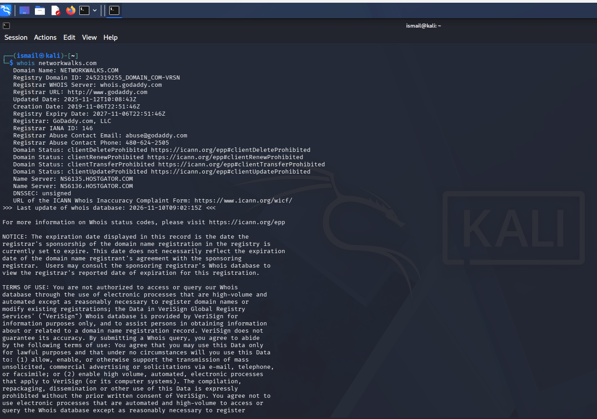
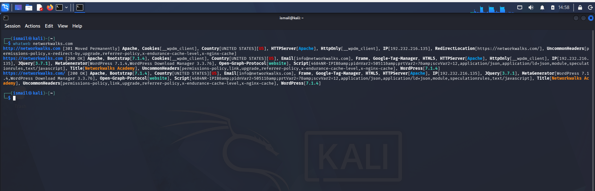
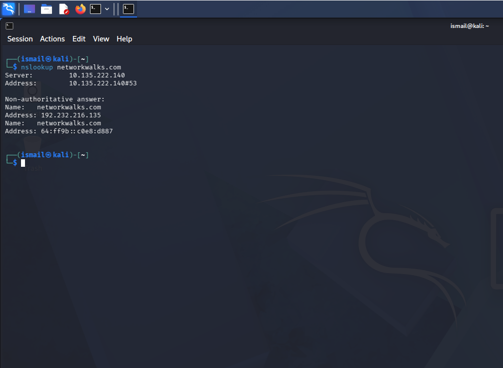
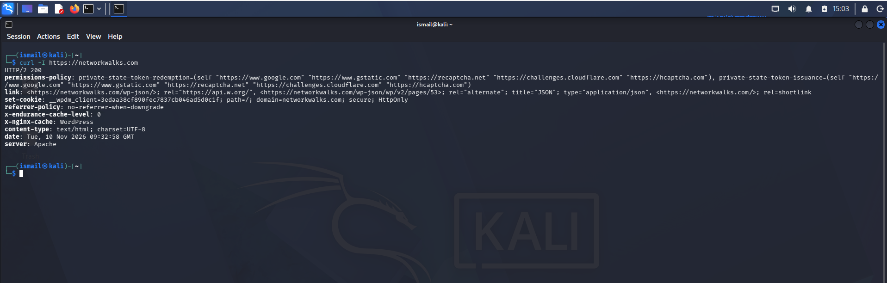
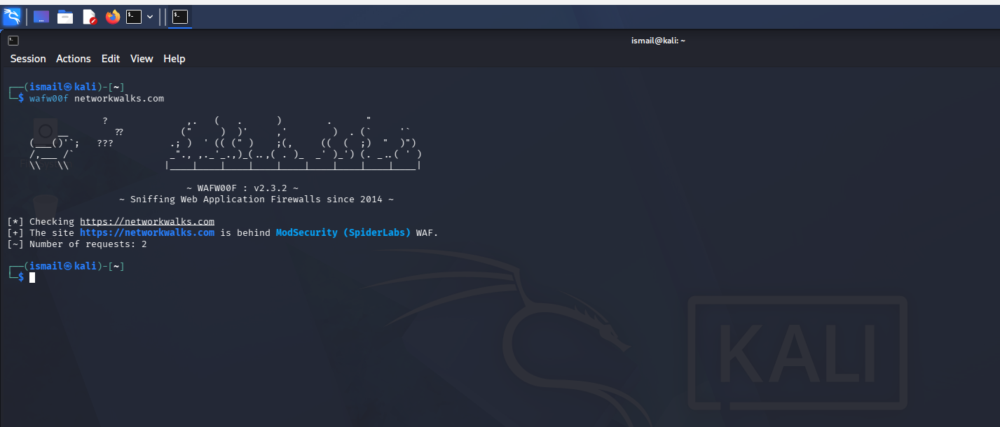
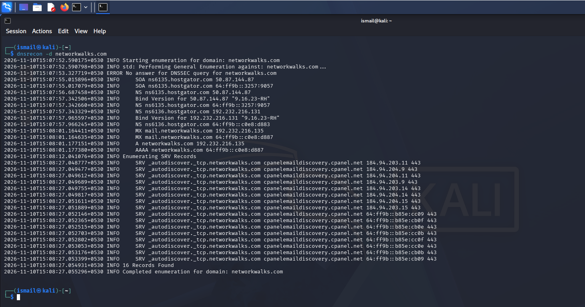
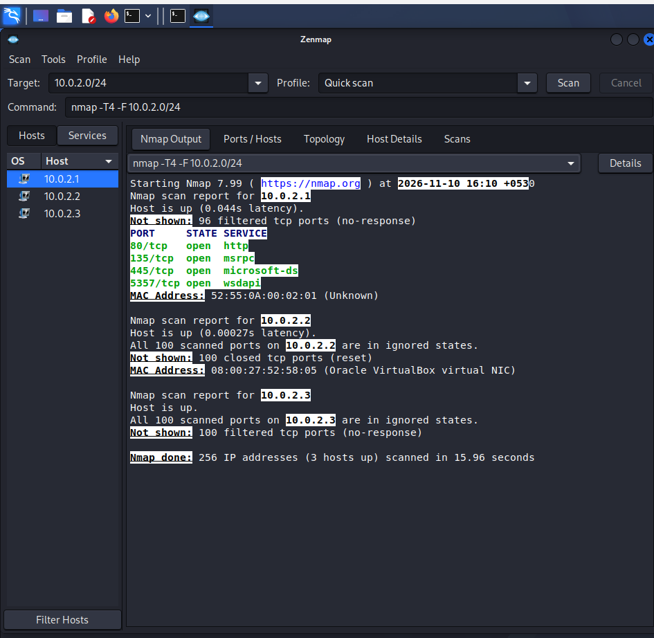
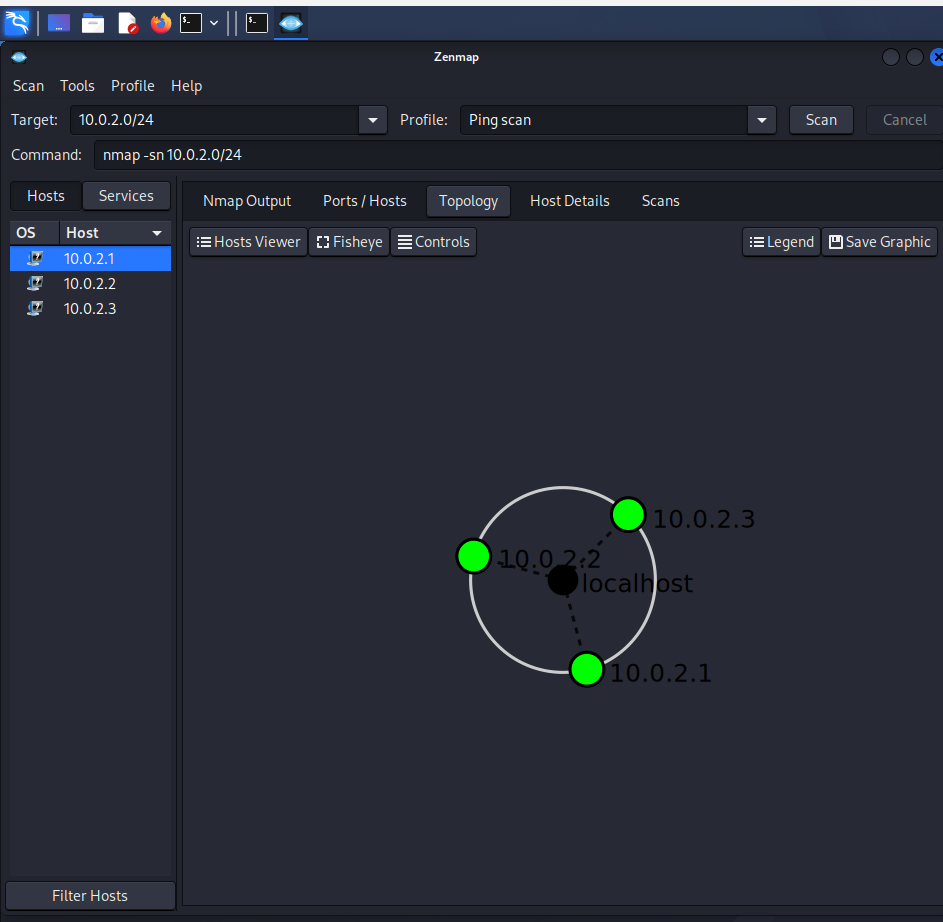

# Penetration-Testing-Report
# Penetration Testing Report

### Footprinting & Network Scanning (Week 2 Project)

**CYBERSECURITY | NETWORKWALKS INTERNSHIP**

| Field | Detail |
| --- | --- |
| **Name** | Katlapudi Mahammad Ismail |
| **Program / Batch** | Networkwalks Cybersecurity Internship, Batch: `<add your batch>` |
| **Date** | 10 November 2026 |
| **Environment** | Kali Linux (footprinting and Zenmap scanning) |
| **Target 1** | `networkwalks.com` (assigned internship lab target) |
| **Target 2** | Lab network `10.0.2.0/24` |
| **Phases covered** | Phase 1: Reconnaissance & Footprinting, Phase 2: Scanning & Network Discovery |

---

## 1. Disclaimer

This work was done only as part of an assigned educational internship lab. Only passive information gathering and basic host or port discovery were performed. No exploitation was attempted. The content is for learning purposes only. Running these tools against systems you do not own or do not have written permission to test is illegal.

## 2. Introduction

This report documents the footprinting of the `networkwalks.com` domain using six Kali Linux tools, followed by network discovery of a lab network (`10.0.2.0/24`) using Zenmap. Footprinting shows how much information about an organization is public. Scanning shows which hosts are alive and which services they expose.

For every step the report gives the command, what was observed, a screenshot as evidence, and why it matters from a security point of view.

## 3. Tools Used

| Tool | Purpose |
| --- | --- |
| whois | Domain registration details (registrar, dates, name servers) |
| whatweb | Fingerprint web technologies (server, CMS, plugins, IP) |
| nslookup | Resolve the domain to its IP addresses using DNS |
| curl -I | Read HTTP response headers |
| wafw00f | Detect whether a Web Application Firewall (WAF) protects the site |
| dnsrecon | Enumerate DNS records (SOA, NS, MX, A, AAAA, SRV) |
| Zenmap (Nmap GUI) | Discover live hosts, open ports, MAC addresses and network topology |

---

## 4. Activities Performed

### 4.1 Footprinting & Reconnaissance (`networkwalks.com`)

**Step 1: WHOIS**

Command: `whois networkwalks.com`

- Registrar: GoDaddy.com, LLC
- Domain created: 6 Nov 2019, registry expiry: 6 Nov 2027
- Name servers: `NS6135.HOSTGATOR.COM`, `NS6136.HOSTGATOR.COM` (the site is hosted on HostGator)
- DNSSEC: unsigned
- Transfer, update, delete and renew locks are enabled (`client...Prohibited`)

Why it matters: registration data tells an attacker who manages the domain and where the DNS is hosted. DNSSEC being unsigned means DNS answers are not cryptographically validated.

**Step 2: WhatWeb**

Command: `whatweb networkwalks.com`

- HTTP redirects to HTTPS (301 Moved Permanently), then 200 OK
- Web server: Apache
- CMS: WordPress 7.1.4, plugin: WordPress Download Manager 3.3.76
- Also detected: jQuery 3.7.1, Bootstrap, Google Tag Manager, HTML5
- Server IP: `192.232.216.135`
- Contact email exposed: `info@networkwalks.com`
- Cookie `__wpdm_client` is set with the HttpOnly flag

Why it matters: knowing the exact CMS, plugin and version lets an attacker look up known vulnerabilities for those versions.

**Step 3: Nslookup**

Command: `nslookup networkwalks.com`

- IPv4 address: `192.232.216.135`
- IPv6 address returned: `64:ff9b::c0e8:d887` (the `64:ff9b::/96` prefix is used by NAT64, and the last 32 bits equal the IPv4 address above)
- The answer was "non-authoritative", meaning it came from a DNS resolver cache

Why it matters: this confirms the public IP of the web service, which becomes the target for scanning.

**Step 4: Curl (HTTP headers)**

Command: `curl -I https://networkwalks.com`

- Response: HTTP/2 200, `server: Apache`
- `x-nginx-cache: WordPress` shows a caching layer is in use
- `link` header exposes the WordPress REST API: `/wp-json/` and `/wp-json/wp/v2/pages/53`
- Cookie is set with `secure` and `HttpOnly`
- `permissions-policy` and `referrer-policy` headers are present
- Security headers such as `Strict-Transport-Security`, `X-Frame-Options`, `Content-Security-Policy` and `X-Content-Type-Options` were not visible in this output

Why it matters: the REST API path confirms WordPress and gives a starting point for further enumeration.

**Step 5: Wafw00f (WAF detection)**

Command: `wafw00f networkwalks.com`

- Result: the site is behind **ModSecurity (SpiderLabs)** WAF (wafw00f v2.3.2, 2 requests)

Why it matters: a WAF filters common attacks, but knowing which WAF is in use tells an attacker what protection they would have to deal with.

**Step 6: DNSRecon**

Command: `dnsrecon -d networkwalks.com`

- SOA and NS records: `ns6135.hostgator.com` (`50.87.144.87`) and `ns6136.hostgator.com` (`192.232.216.131`)
- BIND version exposed by both name servers: `9.16.23-RH`
- MX record: `mail.networkwalks.com` (`192.232.216.135`)
- A record: `192.232.216.135`, AAAA record: `64:ff9b::c0e8:d887`
- SRV records: `_autodiscover._tcp` pointing to `cpanelemaildiscovery.cpanel.net` (port 443)
- DNSSEC query returned no answer, 16 records found in total

Why it matters: DNS records reveal the mail server, the hosting provider and the DNS software version. Exposed software versions help an attacker search for known issues.

### 4.2 Network Scanning with Zenmap (`10.0.2.0/24`)

**Step 7: Quick scan**

Command: `nmap -T4 -F 10.0.2.0/24` (Zenmap profile: Quick scan, Nmap 7.99)

256 IP addresses scanned in 15.96 seconds, 3 hosts up.

| Host | Observation |
| --- | --- |
| `10.0.2.1` | Up. Open ports: 80/http, 135/msrpc, 445/microsoft-ds, 5357/wsdapi. 96 other ports filtered. MAC `52:55:0A:00:02:01` |
| `10.0.2.2` | Up. All 100 scanned ports closed. MAC `08:00:27:52:58:05` (Oracle VirtualBox virtual NIC) |
| `10.0.2.3` | Up. All 100 scanned ports filtered (no response) |

Why it matters: open ports show what services are reachable. Ports 135 and 445 (Windows RPC and SMB) are commonly targeted, so they should not be exposed without a reason.

**Step 8: Ping scan and topology**

Command: `nmap -sn 10.0.2.0/24` (Zenmap profile: Ping scan)

Three live hosts (`10.0.2.1`, `10.0.2.2`, `10.0.2.3`) were found and the Topology tab shows all three connected to the scanning machine (localhost).

Why it matters: a topology map gives a quick picture of which devices are on the network.

---

## 5. Risk Analysis

| # | Finding | Evidence | Potential Impact | Risk |
| --- | --- | --- | --- | --- |
| 1 | CMS and plugin versions exposed | WhatWeb: WordPress 7.1.4, WP Download Manager 3.3.76 | Attackers can search for known vulnerabilities in these exact versions | Medium |
| 2 | DNS server software version exposed | DNSRecon: BIND `9.16.23-RH` on both name servers | Helps attackers look for version-specific weaknesses | Medium |
| 3 | DNSSEC not enabled | WHOIS: DNSSEC unsigned, DNSRecon: no DNSSEC answer | DNS responses could be spoofed or tampered with | Low |
| 4 | WordPress REST API path disclosed | Curl: `/wp-json/` in `link` header | Assists enumeration of the site | Low |
| 5 | Security headers not seen in response | Curl output | Weaker browser-side protection against clickjacking and similar attacks | Low |
| 6 | Server IP and mail server identifiable | nslookup, DNSRecon | Gives attackers an IP and mail host to target | Low |
| 7 | WAF identifiable | Wafw00f: ModSecurity | Reveals part of the security architecture | Low |
| 8 | Windows RPC / SMB ports open on a lab host | Zenmap: `10.0.2.1` has 135 and 445 open | These services are common attack targets if exposed | Medium |

Note: these are observations from information gathering and scanning only. No vulnerability was confirmed or exploited. Further authorized testing would be needed to confirm any actual weakness.

## 6. Recommendations

1. **Keep WordPress and plugins updated** and review them against current security advisories.
2. **Hide unnecessary version information** (web server, CMS, DNS software) where possible.
3. **Add security headers** such as HSTS, X-Frame-Options, Content-Security-Policy and X-Content-Type-Options.
4. **Restrict the WordPress REST API** to what is actually needed.
5. **Enable DNSSEC** if the DNS provider supports it, and review DNS records regularly.
6. **Hide the BIND version** on the name servers.
7. **Keep the WAF (ModSecurity) enabled and tuned**, and monitor its logs.
8. **Close or restrict SMB (445) and RPC (135)** on hosts that do not need them, using a firewall.
9. **Scan your own network regularly**, investigate unknown devices and keep network documentation updated.
10. **Always test only with proper authorization.**

## 7. Conclusion

In this Week 2 project I used six Kali Linux tools to gather information about `networkwalks.com` and Zenmap to discover hosts and services on a lab network. WHOIS and DNSRecon showed the hosting and DNS setup, WhatWeb and Curl identified the web technologies, and Wafw00f identified the WAF. Zenmap showed live hosts, open ports, MAC addresses and the network topology.

The main learning is that a lot of useful information is visible before any attack even starts, and that every finding should be documented with the command, the evidence, the impact and a fix. I also learned that reconnaissance and scanning must stay within an authorized scope.

## 8. Evidence

All screenshots are stored in the `screenshots/` folder:

| File | Content |
| --- | --- |
| `1_whois.png` | WHOIS output |
| `2_whatweb.png` | WhatWeb output |
| `3_nslookup.png` | Nslookup output |
| `4_curl.png` | Curl header output |
| `5_wafw00f.png` | Wafw00f output |
| `6_dnsrecon.png` | DNSRecon output |
| `7_zenmap_quick_scan.png` | Zenmap quick scan |
| `8_zenmap_topology.png` | Zenmap topology |

👤 Author
Katlapudi Mahammad Ismail B.Tech Cybersecurity | Gates Institute of Technology (2023–2027) Batch B084M | NetworkWalks Academy

linkedin : https://www.linkedin.com/in/muhammad-ismail-03743b387
